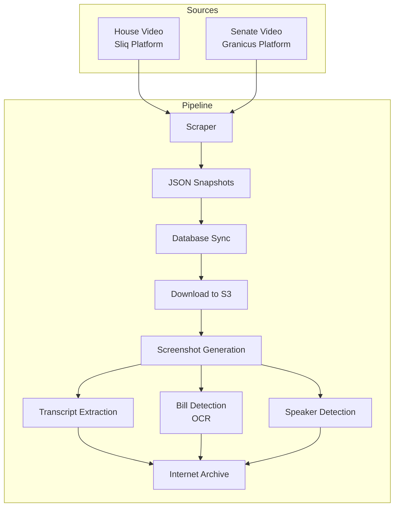

# LLM Instructions

This file provides guidance to LLMs for working with code in this repository.

## About This Project

Richmond Sunlight Video Processor is a standalone pipeline for collecting, processing, and archiving Virginia General Assembly legislative video. It scrapes video metadata from the House and Senate, downloads videos to S3, generates screenshots, extracts transcripts, detects bills being discussed via OCR, identifies speakers, and uploads finalized assets to the Internet Archive.

This repository is part of the `richmondsunlight.com` collection:
- `richmondsunlight.com` - Main website (PHP front-end, source of shared `includes/` directory)
- `rs-api` - Public JSON API
- `rs-machine` - Data ingestion and processing (scrapers, parsers, cron jobs)
- `rs-video-processor` (this repo) - Video ingestion and analysis

## Common Development Commands

### Local Development Setup

**Start the local Docker environment:**
```bash
./docker-run.sh
```

This script builds and starts the container with PHP, ffmpeg, and other required tooling. The first run copies `deploy/settings-docker.inc.php` to `includes/settings.inc.php` if it doesn't exist.

**Stop the Docker environment:**
```bash
./docker-stop.sh
```

### Testing

**Run all tests:**
```bash
./docker-tests.sh
```

This runs PHPUnit inside the Docker container. The test suite includes 40+ unit and integration tests.

**Run tests on native host (requires ffmpeg):**
```bash
./includes/vendor/bin/phpunit
```

Tests self-skip if prerequisites (ffmpeg, MP4 fixtures, API keys) are missing.

**Fetch test video fixtures:**
```bash
php bin/fetch_test_fixtures.php
```

Downloads sample MP4 files from `video.richmondsunlight.com/fixtures` for integration testing.

### Dependency Management

**Install dependencies:**
```bash
composer install
```

Note: Composer is configured to install dependencies to `includes/vendor/` rather than the default `vendor/` directory (matching the richmondsunlight.com pattern).

### Running CLI Scripts

All scripts bootstrap via `bin/bootstrap.php`. Key entry points:

```bash
# Scrape metadata from House/Senate sources
php bin/scrape.php

# Download videos to S3
php bin/fetch_videos.php --limit=N

# Screenshot generation
php bin/generate_screenshots.php --limit=N

# Transcript extraction
php bin/generate_transcripts.php --limit=N

# Bill detection via OCR
php bin/detect_bills.php --limit=N

# Speaker identification
php bin/detect_speakers.php --limit=N

# Release stale in-progress claims so interrupted jobs get retried
php bin/reset_stale_claims.php

# Show pending work and the jobs the pipeline has given up on
php bin/job_status.php

# List rows that share a video or screenshot directory (read-only)
php bin/report_shared_media.php

# Send a video through the whole pipeline again
php bin/requeue_video.php --id=N --apply

# Upload to Internet Archive
php bin/upload_archive.php --limit=N

# Full pipeline orchestration
php bin/pipeline.php
```

## Architecture Overview

### Distributed Queue-Based Design

The system runs across two server configurations:

1. **Lightweight Control Plane** (EC2 Micro instance, shared with rs-machine)
   - Scraping and metadata collection
   - Video downloading to S3
   - (Analysis work is claimed directly from the database by the workers below — there is no separate enqueue step.)

2. **Heavy Analysis Workers** (CPU-optimized EC2 instance; nothing here uses a GPU)
   - Screenshot generation (ffmpeg)
   - Transcript processing (OpenAI Whisper)
   - Bill detection (Tesseract OCR)
   - Speaker detection (diarization)

**Gating:** Analysis only runs if `/home/ubuntu/video-processor.txt` exists on the instance.

### Queue System

The pipeline is database-driven. Each stage's `*JobQueue` class decides what is pending from the `files`, `video_index` and `video_transcript` tables. Two tables used only by this repository add the state those cannot express.

Both are defined with the rest of the shared schema, in the `richmondsunlight.com` repository. This repository never creates tables; `bin/check_schema.php` stops the pipeline if either is missing.

- **`video_jobs`** — one row per video and stage, managed by `JobLedger`. Statuses: `running` (claimed; released after 3 hours), `retry` (failed; hidden until `next_attempt_at`), `failed` (given up after 3 attempts; hidden until reset), `done`.
- **`video_sources`** — the upstream ID of each video, managed by `VideoSourceRegistry`. Imports dedupe on it.

Every queue appends `JobLedger::eligibleSql()` to its `WHERE` clause and exposes `countPending()`. `PendingWork` sums those counts; it is the only definition of "pending", used by `deploy/check-pending-work.sh` and by the `rs-machine` trigger.

Every worker script runs through `StageRunner`: fetch one job, count the attempt, do the work, record the outcome. A stage stops after three consecutive failures, so an outage does not spend an attempt on every pending video.

Two older claim markers remain alongside the ledger:

- **Screenshots:** claimed files get `capture_directory='/pending'`, `capture_rate=0`.
- **Bills/speakers:** a placeholder row is inserted into `video_index` with `ignored='y'`, `raw_text='/pending'`.

`bin/reset_stale_claims.php` releases those after `STALE_CLAIM_MAX_AGE_HOURS` (default 3). A terminal row with `raw_text='/none'`, `ignored='y'` means "the stage ran and found nothing — do not retry."

`php bin/job_status.php` lists what is pending and what has been given up on, with the last error. `--reset-failed` retries everything given up on.

The `src/Queue/` classes (SQS/in-memory `QueueFactory`, `JobDispatcher`) are legacy and are no longer used by the pipeline workers.

### Directory Structure

```
rs-video-processor/
├── bin/                          # CLI entry points
│   ├── bootstrap.php             # Application initialization
│   ├── scrape.php                # Metadata collection
│   ├── fetch_videos.php          # Download to S3
│   ├── generate_screenshots.php  # 1 FPS frame extraction
│   ├── generate_transcripts.php  # Audio transcription
│   ├── detect_bills.php          # OCR-based bill detection
│   ├── detect_speakers.php       # Speaker identification
│   ├── upload_archive.php        # Internet Archive uploads
│   └── pipeline.php              # End-to-end orchestrator
├── src/                          # Core application code (PSR-4)
│   ├── Bootstrap/                # App initialization
│   ├── Scraper/                  # House/Senate metadata collection
│   │   ├── House/                # Sliq platform scraper
│   │   └── Senate/               # Granicus platform scraper
│   ├── Sync/                     # Database synchronization
│   ├── Fetcher/                  # Video downloading
│   ├── Screenshots/              # Frame extraction
│   ├── Transcripts/              # Audio transcription
│   ├── Analysis/                 # Content analysis
│   │   ├── Bills/                # Bill detection via OCR
│   │   └── Speakers/             # Speaker identification
│   ├── Archive/                  # Internet Archive uploads
│   └── Queue/                    # Job orchestration (SQS/in-memory)
├── includes/                     # Shared helpers (from richmondsunlight.com)
│   ├── settings.inc.php          # Configuration constants
│   ├── class.Log.php             # Logging with Slack integration
│   ├── class.Database.php        # PDO connection wrapper
│   └── vendor/                   # Composer dependencies
├── tests/                        # PHPUnit test suite
│   └── fixtures/                 # Test data (HTML, MP4s, JSON)
├── storage/                      # Local file storage
│   ├── scraper/                  # Scraped metadata snapshots
│   ├── pipeline/                 # Pipeline output files
│   └── screenshots/              # Local screenshot cache
└── deploy/                       # Deployment configuration
```

### Data Flow



### Key Design Patterns

**Pluggable Interfaces:**
- `HttpClientInterface` - Swap HTTP implementations
- `OcrEngineInterface` - Replace Tesseract with OpenAI Vision or AWS Rekognition
- `DiarizerInterface` - Swap speaker detection providers
- `QueueInterface` - SQS or in-memory

**Processor Pattern:**
Each analysis step has a dedicated processor class that handles job orchestration, execution, and result persistence.

**Idempotency:**
- Every stage is safe to run repeatedly — job queues re-select unfinished work each run
- Claims (`capture_directory='/pending'`, or `video_index` `/pending` placeholders) prevent duplicate concurrent processing; stale claims are released for retry by `bin/reset_stale_claims.php`
- Database prevents duplicate inserts

### Database Integration

Uses the same MariaDB schema as `richmondsunlight.com`. Key tables:

- `files` - Video metadata (id, chamber, committee_id, title, path, dimensions, date)
- `video_index` - Per-second analysis results (file_id, time, type, linked_id)
- `video_transcript` - Transcript segments (file_id, start_time, end_time, text)
- `people` - Legislator directory for speaker matching
- `committees` - Committee metadata

The shared tables above are used as richmondsunlight.com defines them. Two of the shared schema's tables, `video_sources` and `video_jobs`, are used only by this repository. Like every other table they are defined in the `richmondsunlight.com` repository; `bin/check_schema.php` confirms they exist at the start of every pipeline run.

## Configuration

### Required Constants

Configuration is in `includes/settings.inc.php`. Key constants:

```php
// Database
PDO_DSN, PDO_USERNAME, PDO_PASSWORD

// AWS
AWS_ACCESS_KEY, AWS_SECRET_KEY, AWS_REGION
VIDEO_SQS_URL  // Legacy — no longer used by the pipeline (SQS removed)

// APIs
OPENAI_KEY              // For transcription fallback
IA_ACCESS_KEY, IA_SECRET_KEY  // Internet Archive; deploy.sh writes them to ~/.config/internetarchive/ia.ini
YOUTUBE_API_KEY               // Senate YouTube scraper

// Optional
SLACK_WEBHOOK           // Logging integration
```

For Docker development, use `deploy/settings-docker.inc.php` as a template.

### S3 Bucket Structure

Videos and screenshots are stored in `video.richmondsunlight.com`:

```
video.richmondsunlight.com/
├── house/
│   ├── floor/
│   │   ├── YYYYMMDD-<file id>.mp4
│   │   └── YYYYMMDD-<file id>/        (screenshots and manifest.json)
│   └── committee/{shortname}/
│       ├── YYYYMMDD-<file id>.mp4
│       └── YYYYMMDD-<file id>/
└── senate/
    ├── floor/
    └── committee/{shortname}/
```

The file ID in the key is what keeps two videos from one chamber, committee and day from overwriting each other. Older objects without an ID still exist. `capture_directory` is written once and never moved.

## Coding Standards

### Style Guide

Follow **PSR-12** coding standards. The repository uses modern PHP 8.1+ patterns:
- Typed properties and return types
- Constructor property promotion
- Named arguments where clarity helps

### Variable and Function Naming

- Variables: `$camelCase` in new code, `$snake_case` in legacy includes
- Methods: `camelCase()` in src/, `snake_case()` in includes/
- Classes: `PascalCase`
- Constants: `UPPER_SNAKE_CASE`

### Autoloading

PSR-4 autoloader maps:
- `RichmondSunlight\VideoProcessor\` → `src/`

Legacy code in `includes/` uses require/include.

## Video Source Details

### House Video (Sliq Platform)

- Base URL: `https://sg001-harmony.sliq.net/`
- Listing endpoint: `/en/api/Data/GetListViewData`
- Detail pages contain JavaScript objects: `mediaStartTime`, `AgendaTree`, `downloadMediaUrls`, `Speakers`
- Rate limited: 1 request/second

### Senate Video (Granicus Platform)

- Base URL: `https://virginia-senate.granicus.com/`
- Listing: `/ViewPublisher.php?view_id=3`
- Detail pages parsed from HTML tables
- Rate limited: 1 request/second

## Analysis Details

### Screenshot Generation

- Extracts 1 frame per second via ffmpeg
- Generates two sizes per frame (full resolution + thumbnail)
- Uploads to S3 with predictable naming for downstream OCR

### Transcript Processing

**Priority order:**
1. Existing WebVTT/SRT captions (preferred - reduces API costs)
2. OpenAI Whisper API fallback

Audio is resampled to MP3 (mono, 32 kbps, 16 kHz) and split into 20-minute pieces before API submission, because the API rejects files over 25 MB. Each piece's start time is added to its segments.

### Bill Detection

- OCR-based chyron detection from screenshots
- Chamber-specific crop regions:
  - **Senate:** Bill number in top-right (dark red background)
  - **House:** Bill info in top banner (translucent gray background)
- Falls back to House agenda data when OCR fails
- Results stored in `video_index` table (type='bill')

### Speaker Detection

- House: Extracts from cached `Speakers` metadata object
- Senate: on-screen names read by OCR from screenshots. AWS Transcribe diarization is a paid fallback for floor videos, off unless `SPEAKER_DIARIZATION=1` (set in `deploy/video-processor.env`); it returns anonymous labels
- Fuzzy-matches names to `people` table for legislator IDs
- Results stored in `video_index` (type='legislator')

## Deployment

### Production Infrastructure

- Scraping and metadata collection run on the rs-machine EC2 instance (always-on, low-cost)
- Analysis workers run on a separate CPU-optimized instance (started on-demand)
- Deployed via GitHub Actions → AWS CodeDeploy
- Gated by presence of `/home/ubuntu/video-processor.txt`

### EC2 Instance Management

The video processor EC2 instance is expensive and only started when there's work to do. The `rs-machine` repository contains a cron script (`cron/start_video_processor.php`) that:

1. Scrapes the House and Senate listings and compares them with its last snapshot
2. Counts pending work with `PendingWork` (the same counts the workers use)
3. Starts the instance if there is a new video or any pending work, and it is not already running
4. Once a day, warns if work is pending and no job has been touched for three days

On boot the instance runs `deploy/run-pipeline.sh --drain`: it makes passes until nothing is pending, the 6-hour limit is reached, or the pending count stops dropping, then shuts itself down (`deploy/auto-shutdown.sh`), unless someone is logged in. `idle-shutdown.timer` repeats that check every 15 minutes while no pipeline or `bin/` script is running, so the instance also shuts down after the last person logs out. systemd stops a pipeline run still going after 8 hours (`TimeoutStartSec`).

Worker counts for drain mode, and the switch for paid speaker diarization, are in `deploy/video-processor.env`.

### CI/CD Pipeline

1. PHP syntax linting
2. Composer install
3. PHPUnit test suite
4. Deploy to CodeDeploy (on master branch)

## Development Tips

- **Always use Docker for testing** - ensures ffmpeg and other dependencies are available
- **Workers read straight from the database** - no queue service to configure; claims plus `bin/reset_stale_claims.php` handle coordination and recovery
- **Test fixtures are large** - run `bin/fetch_test_fixtures.php` to download sample videos
- **Check the gating file** - analysis won't run without `/home/ubuntu/video-processor.txt`
- **Scraper output is JSON** - check `storage/scraper/` for debugging metadata collection

## Relationship to Other Repositories

| Repository | Relationship |
|------------|--------------|
| richmondsunlight.com | Source of `includes/` directory (shared classes, settings) |
| rs-api | Consumes `video_index` and `video_transcript` data |
| rs-machine | Triggers video processor EC2 instance; provides committee/legislator data; runs `cron/start_video_processor.php` |

## Known Design Decisions

### Duplicate Video Detection

A video is identified by its upstream ID: `content_id` for House, `clip_id` for Senate Granicus, `youtube_id` for Senate YouTube, stored in `video_sources`. `VideoImporter` checks that first.

Only when the ID has not been seen does it fall back to resemblance: same chamber, date and committee, with lengths within five minutes of each other. A committee can meet twice in one day, so chamber, date and committee alone are not treated as a match.

`MissingVideoFilter` still pre-filters on `chamber|date|duration_seconds` to avoid re-examining videos that are obviously present.

### Speaker Metadata Formats

The `SpeakerMetadataExtractor` supports two formats:
- Raw Sliq format: `Speakers` array with `text` and `startTime` fields
- Normalized format: `speakers` array with `name` and `start_time` fields

This flexibility allows processing both raw scraped data and normalized pipeline output.

### Subcommittee Handling

Subcommittees use the same crop configuration as committees for bill detection OCR, since their video layouts are typically identical.

This is a production-critical system that processes legislative video for public transparency. Changes should be tested thoroughly before deployment.
